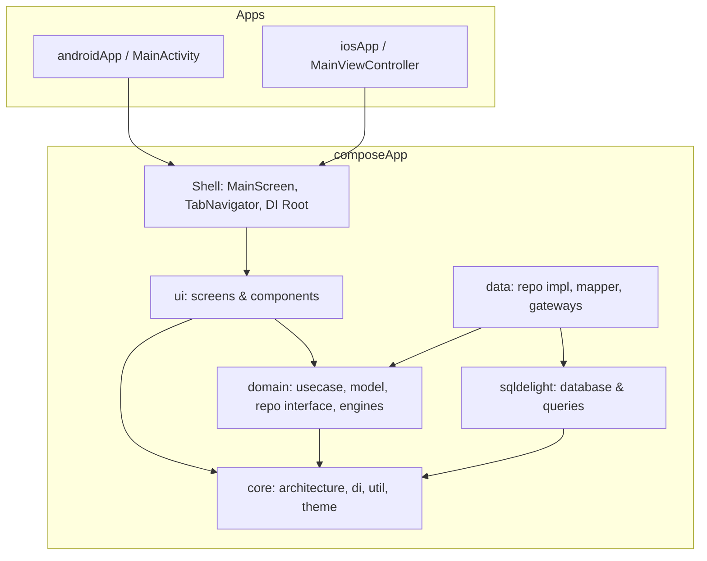

# spendwealthy — Kotlin Multiplatform

> Aplikasi personal finance offline-first untuk individu dan keluarga mengatur uang, budget bulanan, tagihan, cicilan, dokumen finansial, serta laporan keuangan sederhana dengan model subscription yang aman dan teruji.


---

## Daftar Isi

1. [Tujuan & Non-Tujuan](#1-tujuan--non-tujuan)
2. [Prinsip Arsitektur](#2-prinsip-arsitektur)
3. [Gambaran Arsitektur](#3-gambaran-arsitektur)
4. [Struktur Modul](#4-struktur-modul)
5. [Aturan Dependensi](#5-aturan-dependensi)
6. [Tech Stack](#6-tech-stack)
7. [Detail Layer](#7-detail-layer)
8. [State Management & UI](#8-state-management--ui)
9. [Navigasi](#9-navigasi)
10. [Dependency Injection](#10-dependency-injection)
11. [Networking](#11-networking)
12. [Persistensi & Offline](#12-persistensi--offline)
13. [Error Handling](#13-error-handling)
14. [Concurrency](#14-concurrency)
15. [Platform-Specific (expect/actual & Gateways)](#15-platform-specific-expectactual)
16. [Testing Strategy](#16-testing-strategy)
17. [Security](#17-security)
18. [Observability](#18-observability)
19. [Performance](#19-performance)
20. [Build System & Convention Plugins](#20-build-system--convention-plugins)
21. [CI/CD & Release](#21-cicd--release)
22. [Code Quality & Konvensi](#22-code-quality--konvensi)
23. [Workflow Tim](#23-workflow-tim)
24. [Getting Started](#24-getting-started)
25. [Troubleshooting](#25-troubleshooting)
26. [ADR](#26-architecture-decision-records-adr)
27. [Definition of Done](#27-definition-of-done)
28. [Roadmap & Tech Debt](#28-roadmap--tech-debt)

---

## 1. Tujuan & Non-Tujuan

**Tujuan**
- Share **business logic, data, dan UI (Compose Multiplatform)** lintas Android & iOS untuk mengurangi duplikasi dan inkonsistensi perilaku.
- Arsitektur **testable, modular, scalable** untuk banyak engineer / tim paralel.
- Build cepat (incremental, build cache, parallel execution).
- Perilaku konsisten, offline-first reliability, dan rilis yang dapat diprediksi.

**Non-Tujuan**
- Bukan 100% code sharing tanpa memedulikan platform. Share bila ada ROI; gunakan platform-specific gateways bila API hardware/OS native (biometrik, keychain, notifikasi lokal) lebih superior.
- Tidak menyembunyikan platform behavior di balik abstraksi berlebihan.

---

## 2. Prinsip Arsitektur

1. **Share logic dulu, UI konsisten.** Domain + data = share penuh. UI shared via Compose Multiplatform (tercatat di ADR-001).
2. **Dependency rule.** Dependensi mengarah ke dalam (ke domain). Domain tidak tahu framework atau platform SDK.
3. **Unidirectional Data Flow (UDF).** `Event → ViewModel → State → UI`. Satu sumber state per layar.
4. **Interface di domain, implementasi di data.** Memudahkan fake dan testing.
5. **Prefer composition over `expect/actual`.** Gunakan interface + DI; `expect/actual` hanya untuk primitif platform kecil (Database driver, platform metadata).
6. **Immutable state, explicit side effect.**
7. **Explicit mapping** DTO ↔ Entity ↔ Domain ↔ UI model.
8. **Fail explicit.** Error domain bertipe sealed (`DomainError`, `Outcome<T, E>`), bukan unhandled exception liar.
9. **Feature isolation.** Modul/fitur tidak saling bergantung secara sirkuler; komunikasi lewat kontrak atau navigasi type-safe.
10. **Make it work, make it right, make it fast, dalam urutan itu.**

---

## 3. Gambaran Arsitektur



**Layering per fitur**

```
UI (Composable)  ──events──▶  ViewModel  ──calls──▶  UseCase / Engine  ──▶  Repository (interface)
       ▲                          │                                                 ▲
       └────── UiState ───────────┘                                   Repository impl (data layer)
                                                                       ├─ Remote (Ktor)
                                                                       └─ Local  (SQLDelight DB)
```

---

## 4. Struktur Modul & Folder

```
composeApp/
├── src/
│   ├── commonMain/kotlin/com/spendwealthy/app/
│   │   ├── core/
│   │   │   ├── architecture/    # BaseViewModel, DispatcherProvider, Outcome, UiText
│   │   │   ├── db/              # DriverFactory (expect), adapters
│   │   │   ├── di/              # Koin Modules (commonModule, platformModule)
│   │   │   └── util/            # FormattingUtils, DateRanges, Serializers
│   │   ├── domain/
│   │   │   ├── model/           # Money, Wallet, Transaction, Goal, DomainError
│   │   │   ├── gateway/         # BiometricGateway, SecureStorage, NotificationScheduler
│   │   │   ├── repository/      # TransactionRepository, WalletRepository, dll.
│   │   │   ├── service/         # SafeToSpendEngine, AnomalyDetection, WealthScore
│   │   │   └── usecase/         # AddTransactionUseCase, ExportMonthlyTransactionsCsv
│   │   ├── data/
│   │   │   ├── gateway/         # Multiplatform & in-memory fallback gateways
│   │   │   ├── mapper/          # SQLDelight Entity <-> Domain mappers
│   │   │   └── repository/      # SQLDelight repository implementations
│   │   └── ui/
│   │       ├── components/      # CatPad, AppButton, AppTextField, ConfettiView
│   │       ├── theme/           # AppColors, AppTypography, AppSpacing, Theme
│   │       ├── main/            # MainScreen, FloatingBottomNav, ScanFab
│   │       └── screens/         # home, transaction, budget, bill, vault, family
│   ├── androidMain/             # Android bindings (API 24 - 35)
│   │   └── .../data/gateway/    # AndroidSecureStorage, AndroidNotificationScheduler, FileShare
│   └── iosMain/                 # iOS Native bindings (iOS 14 - 18)
│       └── .../data/gateway/    # IosSecureStorage, IosNotificationScheduler, IosBiometric, FileShare
```

---

## 5. Aturan Dependensi

| Dari ↓ / Ke → | composeApp (root) | ui | domain | data | sqldelight/db | core |
|---|:-:|:-:|:-:|:-:|:-:|:-:|
| **composeApp shell** | – | ✅ | ✅ | ✅ (DI wiring) | ✅ | ✅ |
| **ui (presentation)** | ❌ | – | ✅ | ❌ | ❌ | ✅ |
| **domain** | ❌ | ❌ | – | ❌ | ❌ | ✅ |
| **data** | ❌ | ❌ | ✅ | – | ✅ | ✅ |
| **sqldelight / db** | ❌ | ❌ | ❌ | ❌ | – | ✅ |

---

## 6. Tech Stack

| Concern | Pilihan | Alasan / Catatan |
|---|---|---|
| Bahasa | Kotlin 2.0.21 (K2 compiler) | Satu bahasa lintas platform dengan optimasi multiplatform terbaru |
| UI shared | Compose Multiplatform 1.7.0 | Konsistensi UI 1:1 di Android & iOS dengan Skiko engine |
| Arsitektur UI | MVI / MVVM + UDF | `BaseViewModel<State, Event, Effect>`, `StateFlow<UiState>` |
| ViewModel | `androidx.lifecycle` ViewModel | Lifecycle-aware, `viewModelScope` terintegrasi |
| Navigasi | Voyager 1.1.0-beta03 | Type-safe screen navigation, tab navigator, Koin integration |
| DI | Koin 4.0.0 | Multiplatform lightweight DI, constructor injection |
| HTTP | Ktor Client 3.0.1 | OkHttp (Android), Darwin (iOS) |
| Serialization | kotlinx.serialization 1.7.3 | Reflection-free, KMP native |
| Database | SQLDelight 2.0.2 | SQLite native offline-first, type-safe `.sq` queries |
| Concurrency | Kotlin Coroutines & Flow | Structured concurrency dengan `DispatcherProvider` |
| Date/Time | kotlinx-datetime 0.6.1 | Standar waktu multiplatform |

---

## 7. Detail Layer

### 7.1 Domain (`com.spendwealthy.app.domain`)
- **Entity/Model**: Data class immutable murni (`Money`, `Transaction`, `Wallet`).
- **Engines / Services**: Logika kalkulasi bisnis murni (`SafeToSpendEngine`, `AnomalyDetectionEngine`, `WealthScoreEngine`).
- **Repository Interface**: Kontrak persistensi yang mengembalikan `Flow<T>` atau one-shot `suspend fun`.
- **Gateway Interface**: Kontrak abstraksi perangkat keras/OS (`BiometricGateway`, `SecureStorage`, `NotificationScheduler`).

### 7.2 Data (`com.spendwealthy.app.data`)
- Implementasi repository; orkestrasi database SQLDelight lokal.
- **Single Source of Truth = SQLite DB lokal**.
- Explicit mapping: `TransactionMapper.kt`, `WalletMapper.kt`, dll.
- Strategi retry dan error mapping diisolasi di layer data.

### 7.3 Presentation (`com.spendwealthy.app.ui`)
- ViewModel mengubah event → state, memanggil UseCase/Engine.
- Composable stateless dengan haptic feedback dan mikro-interaksi responsif.

---

## 8. State Management & UI

Menggunakan `BaseViewModel<State, Event, Effect>`:
- State tunggal diekspos sebagai `StateFlow<UiState>`.
- One-off effect (navigasi, pesan toast, getaran) dialirkan via `Channel.BUFFERED`.
- String UI menggunakan abstraksi `UiText`.

---

## 9. Navigasi

Menggunakan **Voyager**:
- Rute berbasis objek Screen yang mengimplementasikan `cafe.adriel.voyager.core.screen.Screen`.
- Shell navigasi utama dikelola oleh `TabNavigator` (HomeTab, TransactionTab, BudgetTab, VaultTab).
- Layar modal (AddTransaction, AddBill, AddWallet) dibuka di atas `rootNavigator`.

---

## 10. Dependency Injection

Menggunakan **Koin**:
- `commonModule` mengikat database, repository, service engine, usecase, dan viewModel.
- `platformModule` (expect/actual) mengikat gateway native spesifik Android dan iOS.

---

## 11. Persistensi & Offline-First

- **SQLDelight** menghasilkan API database type-safe dari file query `.sq`.
- Semua transaksi, dompet, tagihan, dan budget disimpan secara lokal terlebih dahulu (*Zero Network Dependency for core features*).

---

## 12. Concurrency & Dispatchers

- Disuntikkan melalui antarmuka `DispatcherProvider` (`main`, `io`, `default`, `unconfined`).
- Menghindari pemanggilan hardcode `Dispatchers.IO` di layer bisnis agar dapat diuji secara deterministik di unit test.

---

## 13. Platform-Specific Gateways

Platform hardware dan sistem operasi diakses melalui antarmuka domain:
- **`SecureStorage`**: Android (AndroidKeyStore + AES-GCM + SharedPreferences), iOS (NSUserDefaults partisi terisolasi / Keychain).
- **`NotificationScheduler`**: Android (`AlarmManager` + `BroadcastReceiver`), iOS (`UNUserNotificationCenter`).
- **`BiometricGateway`**: Android (`androidx.biometric`), iOS (`LocalAuthentication.LAContext` untuk Face ID & Touch ID).
- **`FileShareGateway`**: Android (`FileProvider` + `Intent.ACTION_SEND`), iOS (`UIActivityViewController`).

---

## 14. Architecture Decision Records (ADR)

Tercatat di `docs/adr/`:
- [ADR-001: Pendekatan UI — Compose Multiplatform](docs/adr/ADR-001-ui-approach.md)
- [ADR-002: Solusi Navigasi — Voyager](docs/adr/ADR-002-navigation.md)
- [ADR-003: Dependency Injection — Koin](docs/adr/ADR-003-dependency-injection.md)
- [ADR-004: Persistensi Data Lokal — SQLDelight](docs/adr/ADR-004-persistence-sqldelight.md)
- [ADR-005: Strategi Error Handling — Outcome & DomainError](docs/adr/ADR-005-error-handling-and-outcomes.md)

---

## 15. Getting Started

### Prasyarat
- JDK 17+
- Android Studio Koala / Ladybug+
- Xcode 15+ (untuk target iOS di macOS)

### Shortcut Menjalankan Instan (1-Command Runner)

Tersedia skrip runner cerdas dan Makefile yang otomatis mendeteksi, mem-boot simulator, membuka jendela aplikasi, dan meluncurkan SpendWealthy:

```bash
# iOS Simulator (Otomatis boot iPhone simulator & buka jendela Simulator.app)
make ios
# atau: ./run.sh ios (atau: ./run.sh fast-ios untuk launch < 2 detik)

# Android Emulator / Device (Otomatis deteksi AVD, install APK & launch MainActivity)
make android
# atau: ./run.sh android

# Menjalankan KEDUA platform sekaligus (Android + iOS side-by-side)
make both
# atau: ./run.sh both

# Menjalankan seluruh 33 unit tests
make test
# atau: ./run.sh test
```

### Manual Gradle Commands

```bash
# Kompilasi Android Debug
./gradlew :composeApp:compileDebugKotlinAndroid

# Kompilasi iOS Simulator
./gradlew :composeApp:compileKotlinIosSimulatorArm64

# Menjalankan via Gradle Tasks
./gradlew runIos
./gradlew runAndroid
```

---

## 16. Definition of Done (DoD)

- [x] Arsitektur Clean Architecture terpisah tegas (Core, Domain, Data, UI).
- [x] Paritas gateway platform teruji pada Android dan iOS (Biometrik, Notifikasi, Secure Storage, Share Sheet).
- [x] Pengujian kompilasi hijau tanpa warning blocker di Gradle.
- [x] Input ergonomis mata uang Rupiah (`CatPad`) dengan tombol `000`, quick pills, dan haptic feedback.
- [x] ADR terdokumentasi lengkap di direktori `docs/adr/`.